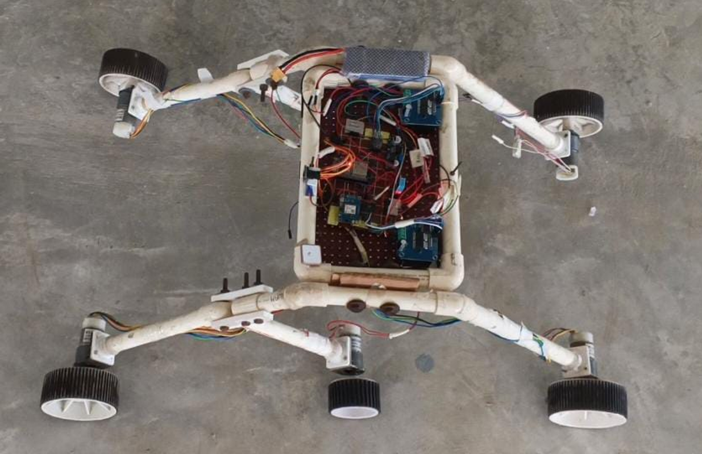
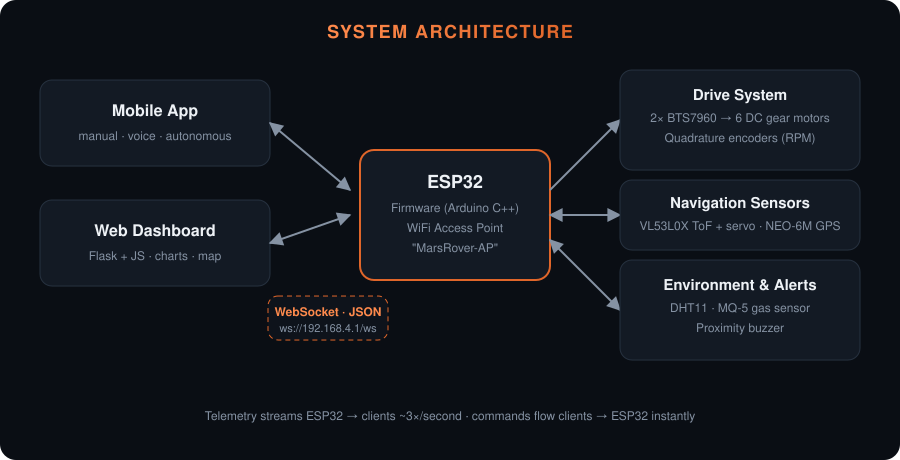
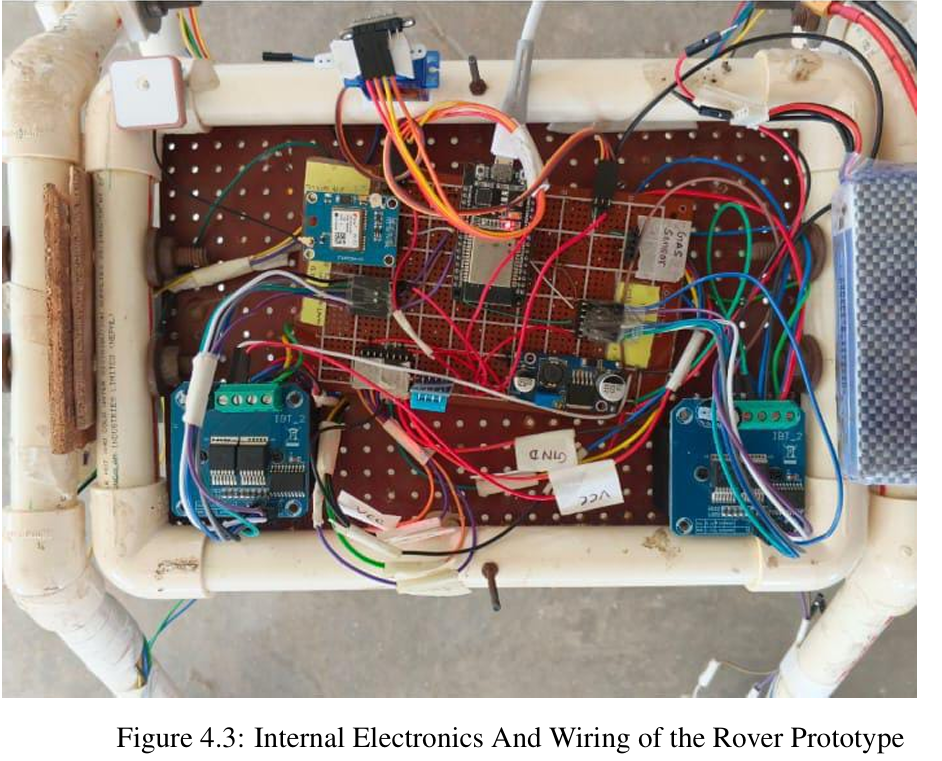
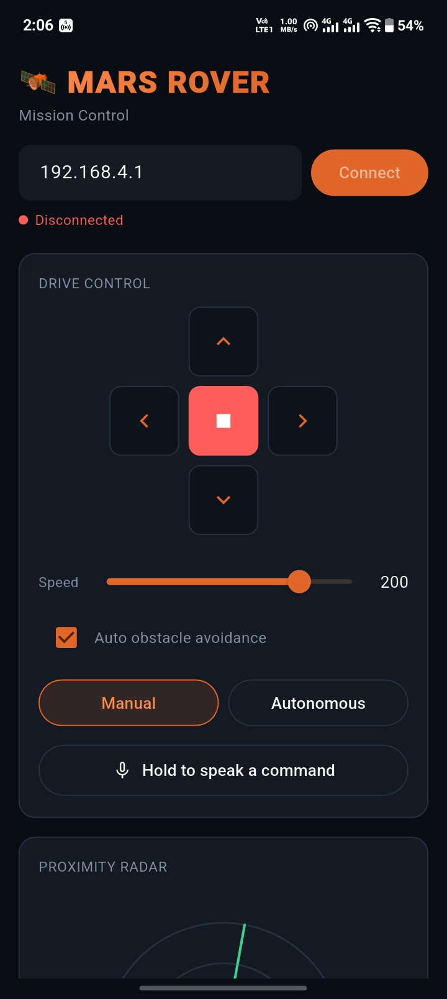
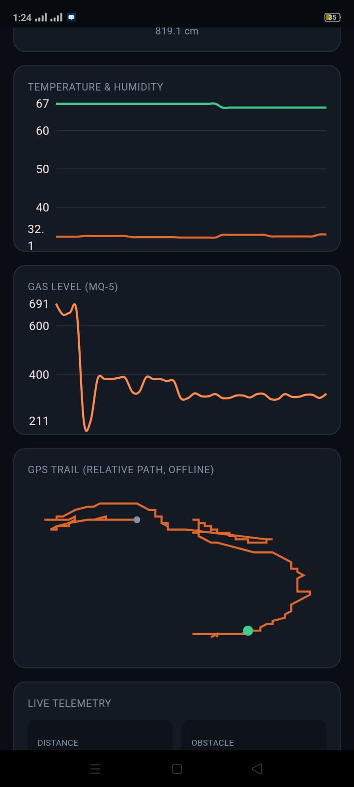
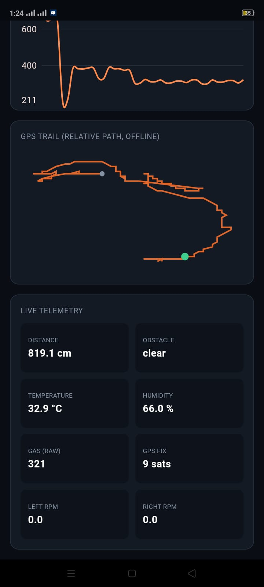

<div align="center">

# 🛰️ Autonomous Terrain Exploration Rover
### with Wireless Communication and Sensor Integration

*A six-wheel, multi-sensor ESP32 rover that drives manually, by voice, or on its own — streaming live telemetry over its own WiFi network.*


<!-- Replace with your best photo of the rover. Keep the filename. -->


</div>

---

## 📖 Overview

This is the minor project for the 6th semester of the Electronics, Communication and Information Engineering program at TU IOE Purwanchal Campus, Dharan. The rover combines embedded systems, wireless networking and sensor integration into one working robot, framed around a **search-and-rescue / hazardous-environment reconnaissance** use case.

It avoids obstacles with a time-of-flight sensor on a scanning servo, tracks its position with GPS, and monitors temperature, humidity and flammable gas. The ESP32 hosts **its own WiFi network**, so no router or internet is needed in the field.

## ✨ Features

| | |
|---|---|
| 🚗 **Drive** | Six-wheel skid-steer, dual BTS7960 drivers, three motors per side |
| 📊 **Feedback** | Quadrature encoders on the front wheels → live wheel RPM |
| 🛑 **Obstacle avoidance** | Stops at <60 cm → backs up → servo-scans left/right → turns toward the open side at reduced speed |
| 🤖 **Modes** | Manual, voice-commanded, or autonomous wander — manual input always overrides |
| 📡 **Location** | NEO-6M GPS with a live breadcrumb trail |
| 🌡️ **Environment** | DHT11 temperature/humidity and MQ-5 gas hazard monitoring |
| 🔊 **Alerts** | Buzzer + radar-style indicator when something is in range |
| 🛡️ **Fail-safe** | Motors stop automatically if no controller is connected |
| 📶 **Connectivity** | Self-hosted WiFi Access Point + WebSocket (JSON) — no router needed |

## 🏗️ System Architecture

<div align="center">

</div>

The ESP32 broadcasts the `MarsRover-AP` network. Any client — a phone app or the browser dashboard in this repo — connects to `ws://192.168.4.1/ws` and speaks the same small JSON protocol.

## 📸 Gallery

### The Rover

<!-- Add 3–4 real photos of the build. Same filenames as below, or edit the paths. -->
<table>
  <tr>
    <td></td>
    <td></td>
    
  </tr>
  <tr align="center">
    <td><sub>Top view</sub></td>
    <td><sub>Electronics &amp; wiring</sub></td>
  </tr>
</table>

### Mobile App (companion controller)

A companion mobile app drives the rover over the same WebSocket protocol — D-pad, speed control, manual/autonomous toggle, voice commands, animated radar, live charts and an offline GPS trail.

<table>
  <tr>
    <td></td>
    <td></td>
    <td></td>
  </tr>
  <tr align="center">
    <td><sub>Drive controls</sub></td>
    <td><sub>Live Graph</sub></td>
    <td><sub>Live telemetry</sub></td>
  </tr>
</table>


## 🔧 Hardware

| Component | Role |
|---|---|
| ESP32 DevKit | Main controller: WiFi AP, sensor I/O, PWM motor control |
| 2× BTS7960 | High-current motor drivers (one per side) |
| 6× DC gear motors | Drive wheels; front-left and front-right carry encoders |
| VL53L0X + servo | Time-of-flight distance sensor on a panning mount |
| NEO-6M | GPS receiver |
| DHT11 | Temperature &amp; humidity |
| MQ-5 | Flammable / harmful gas sensor |
| Active buzzer | Proximity alarm |
| 3S LiPo (11.1 V) | Motor power; ESP32 on a separate regulated 5 V rail |

### ESP32 Pin Map

| Function | GPIO |
|---|---|
| Left driver (RPWM / LPWM / EN) | 18 / 19 / 5 |
| Right driver (RPWM / LPWM / EN) | 27 / 14 / 23 |
| Left encoder (A / B) | 25 / 26 |
| Right encoder (A / B) | 32 / 33 |
| GPS (RX2 / TX2) | 16 / 17 |
| ToF (SDA / SCL) | 21 / 22 |
| Servo | 13 |
| DHT11 | 4 |
| MQ-5 (analog) | 34 |
| Buzzer | 15 |

> **Power note:** keep the ESP32 on its own regulated supply and share only ground with the motor rail. Motor stall currents cause voltage sag that can brown out the ESP32 if they share a rail.

## 🚀 Getting Started

### 1. Flash the firmware
1. Open `firmware/mars_rover_main/` in **Arduino IDE** (the folder name must match the `.ino` filename).
2. Install these libraries from the Library Manager:
   `ESPAsyncWebServer` + `AsyncTCP`, `ArduinoJson` (v6), `TinyGPS++`, `Adafruit VL53L0X`, `ESP32Servo`, `DHT sensor library`.
3. Select your ESP32 board and upload.
4. The rover now broadcasts **`MarsRover-AP`** (credentials are defined near the top of the sketch).

### 2. Run the web dashboard
```bash
cd web_dashboard
pip install -r requirements.txt
python app.py
```
Open `http://127.0.0.1:5000`. Connect your computer's WiFi to `MarsRover-AP`, enter `192.168.4.1` in the IP box and press **Connect**.

> The dashboard's map and chart panels load libraries from a CDN, so they need internet. Drive controls, telemetry values and the radar work fully offline.

## 📡 Communication Protocol

Everything runs over one WebSocket (`ws://<esp32-ip>/ws`) exchanging small JSON messages, so you can write your own client in any language.

**Commands (client → rover)**
```
{"cmd": "forward"}          forward | backward | left | right | stop
{"speed": 200}              0–255
{"auto_mode": true}         autonomous wander on/off
{"auto_avoid": true}        obstacle avoidance on/off
```

**Telemetry (rover → client, ~3×/s)**
```json
{
  "distance_mm": 850, "obstacle": false,
  "temp_c": 26.4, "humidity": 58.0, "gas_raw": 312,
  "left_rpm": 45.2, "right_rpm": 44.8,
  "lat": 27.6881, "lng": 83.4325, "sats": 7, "gps_fix": true,
  "command": "forward", "speed_pwm": 200, "auto_mode": false
}
```

## ⚠️ Known Limitations & Future Work

- Obstacle avoidance is **reactive** (scan-and-turn), not path planning or SLAM.
- Motor speed is open-loop — encoder RPM feedback is in place as the foundation for **PID speed control**.
- GPS breadcrumbs exist as the foundation for **return-to-start navigation**.
- Range is limited to WiFi coverage; long-range operation would need LoRa or similar.
- Traffic is unencrypted (`ws://`) — acceptable on a closed local network for an academic project.


**Ram Gautam** — Electronics, Communication and Information Engineering, TU IOE Purwanchal Campus, Dharan, Nepal
Robotics · IoT · Embedded Systems

